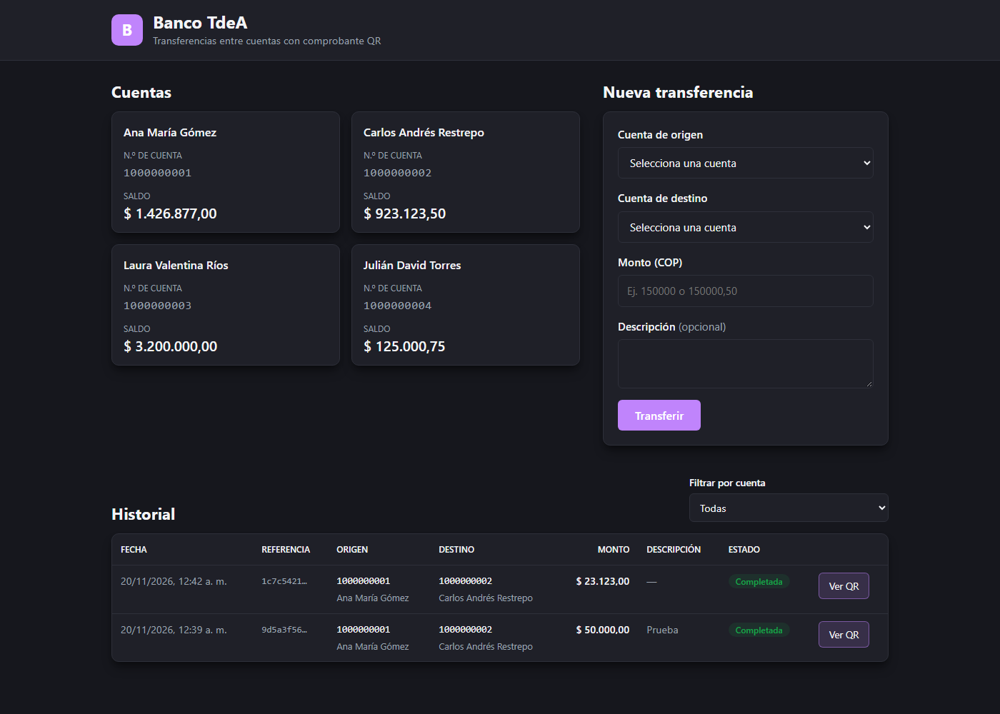
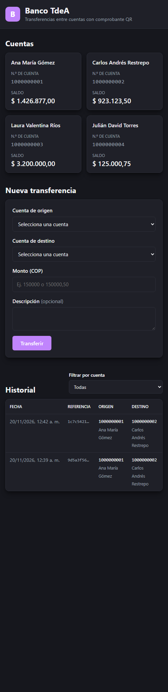
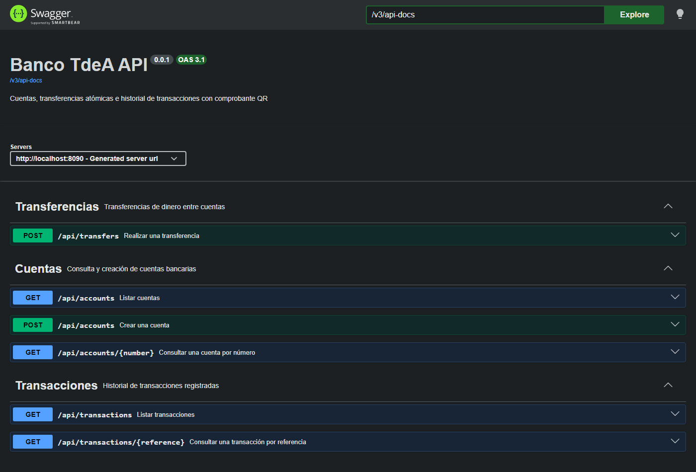

# Banco TdeA: transferencias bancarias con QR

Sistema web para gestionar cuentas bancarias y hacer **transferencias atómicas** entre ellas. Cada transferencia genera un **comprobante con código QR** que se puede descargar como imagen PNG.

- **Backend:** API REST en Spring Boot 4 (Java 25) con PostgreSQL. Garantiza la atomicidad y la consistencia del dinero con `BigDecimal`, `@Transactional` y bloqueo optimista.
- **Frontend:** SPA en React 19 + Vite. Muestra las cuentas, el formulario de transferencia, el historial filtrable y los comprobantes QR.



---

## Contenido

1. [Funcionalidades](#funcionalidades)
2. [Stack tecnológico](#stack-tecnológico)
3. [Arquitectura](#arquitectura)
4. [Modelo de datos](#modelo-de-datos)
5. [API REST](#api-rest)
6. [Reglas de negocio](#reglas-de-negocio)
7. [Código QR](#código-qr)
8. [Requisitos previos](#requisitos-previos)
9. [Configuración de la base de datos](#configuración-de-la-base-de-datos)
10. [Ejecución](#ejecución)
11. [Capturas](#capturas)

---

## Funcionalidades

- Consultar las cuentas con su titular y su saldo en pesos colombianos (COP).
- Transferir dinero entre cuentas, con validación en el frontend y en el backend.
- Ver el comprobante de cada transferencia con un código QR descargable como PNG.
- Consultar el historial de transacciones (más recientes primero), filtrado por cuenta.
- Crear cuentas nuevas por API.
- Documentación interactiva de la API con Swagger UI.
- Datos de prueba: 4 cuentas que se insertan solas si la base está vacía.

---

## Stack tecnológico

Versiones tomadas de `backend/build.gradle`, `frontend/package.json` y las dependencias resueltas.

### Backend

| Tecnología | Versión | Uso |
|---|---|---|
| Java | 25 (toolchain) | Lenguaje |
| Spring Boot | 4.1.2 | Framework base |
| Spring Web MVC | 7.0.10 | API REST (`spring-boot-starter-webmvc`) |
| Spring Data JPA | 4.1.2 | Repositorios (`spring-boot-starter-data-jpa`) |
| Hibernate ORM | 7.4.13.Final | Implementación JPA |
| Bean Validation | Spring Boot 4.1.2 | Validación de DTO (`spring-boot-starter-validation`) |
| springdoc-openapi | 3.2.0 | OpenAPI 3.1 + Swagger UI |
| PostgreSQL JDBC | 42.7.14 | Driver de base de datos |
| HikariCP | 7.0.2 | Pool de conexiones |
| Spring Boot DevTools | 4.1.2 | Reinicio automático en desarrollo |
| Gradle | 9.9.1 (wrapper) | Build |

### Frontend

| Tecnología | Versión | Uso |
|---|---|---|
| React / React DOM | 19.3.1 | Interfaz |
| Vite | 8.3.8 | Servidor de desarrollo y build |
| @vitejs/plugin-react | 6.3.0 | Integración React en Vite |
| Axios | 1.21.1 | Cliente HTTP |
| qrcode.react | 4.2.0 | Generación del QR (`QRCodeSVG`) |
| oxlint | 1.94.0 | Lint |

### Base de datos

PostgreSQL (probado con la versión local en `localhost:5432`).

---

## Arquitectura

```
┌──────────────────────┐   HTTP/JSON   ┌─────────────────────────────────────────────┐     JDBC     ┌────────────┐
│  Frontend (React)    │ ────────────▶ │  Backend (Spring Boot)                      │ ───────────▶ │ PostgreSQL │
│  components ⇄ hooks  │               │  Controller → Service → Repository → Entity │              │  banktdea  │
│  services (Axios)    │ ◀──────────── │  DTO (records) · Mapper · ExceptionHandler  │ ◀─────────── │            │
└──────────────────────┘               └─────────────────────────────────────────────┘              └────────────┘
```

### Capas del backend

| Capa | Paquete | Responsabilidad |
|---|---|---|
| Controlador | `controller` | Recibe la petición HTTP, valida con `@Valid` y delega al servicio. Sin lógica de negocio. Documentado con `@Tag` / `@Operation`. |
| Servicio | `service` | Reglas de negocio y límites transaccionales (`@Transactional`; `readOnly = true` en las lecturas). |
| Repositorio | `repository` | Acceso a datos con Spring Data JPA. Las consultas de transacciones traen las cuentas en la misma consulta (`JOIN FETCH` / `@EntityGraph`) para evitar N+1. |
| Entidad | `entity` | Modelo JPA (`Account`, `Transaction`, `TransactionStatus`). |
| DTO | `dto` | Java records de entrada y salida con Bean Validation. Las entidades nunca se exponen en la API. |
| Mapper | `mapper` | Conversión entidad ⇄ DTO. |
| Excepciones | `exception` | Excepciones de dominio y `GlobalExceptionHandler` (`@RestControllerAdvice`). |
| Configuración | `config` | CORS, metadatos de OpenAPI y carga de datos de prueba. |

### Capas del frontend

| Capa | Carpeta | Responsabilidad |
|---|---|---|
| Servicios | `src/services` | Llamadas HTTP con una instancia compartida de Axios (`apiClient.js`), un archivo por recurso. Un interceptor convierte cada error en un `Error` con el mensaje del backend. |
| Hooks | `src/hooks` | Estado, efectos, validación y llamadas a servicios. Un hook por componente con lógica. |
| Componentes | `src/components` | Vistas que solo contienen JSX, cada una con su `.css` y clases prefijadas (`account-list__card`). |
| Utilidades | `src/utils` | Funciones puras: formato COP y de fechas, y comparación de montos sin punto flotante. |
| Estilos | `src/styles` | Variables CSS globales y reset (tema claro y oscuro). |

### Estructura de carpetas

```
.
├── CLAUDE.md                      # Instrucciones del proyecto para Claude Code
├── README.md
├── .claude/rules/                 # Reglas de código del backend y del frontend
│   ├── springboot.md
│   └── react.md
├── docs/
│   ├── prompts.md                 # Prompts usados para construir el proyecto
│   └── screenshots/
├── backend/
│   ├── build.gradle
│   └── src/main/
│       ├── java/com/tdea/apptdea/
│       │   ├── ApptdeaApplication.java
│       │   ├── config/            # CorsConfig, OpenApiConfig, DataSeeder
│       │   ├── controller/        # AccountController, TransferController, TransactionController
│       │   ├── dto/               # AccountRequest/Response, TransferRequest, TransactionResponse, ErrorResponse
│       │   ├── entity/            # Account, Transaction, TransactionStatus
│       │   ├── exception/         # BusinessRule, InsufficientFunds, ResourceNotFound, GlobalExceptionHandler
│       │   ├── mapper/            # AccountMapper, TransactionMapper
│       │   ├── repository/        # AccountRepository, TransactionRepository
│       │   └── service/           # AccountService, TransferService, TransactionService
│       └── resources/
│           ├── application.properties                 # perfil default
│           ├── application-local.properties.example   # plantilla del perfil local
│           └── application-local.properties           # perfil local (no versionado)
└── frontend/
    ├── .env.example
    ├── vite.config.js             # puerto 3000, strictPort
    └── src/
        ├── App.jsx / App.css      # Encabezado + Cuentas, Nueva transferencia, Historial
        ├── components/            # AccountList, TransferForm, TransactionHistory, TransactionReceipt, Toast
        ├── hooks/                 # useAccounts, useTransferForm, useTransactionHistory, useTransactionReceipt, useToast
        ├── services/              # apiClient, accountService, transferService, transactionService
        ├── styles/global.css
        └── utils/                 # format.js, decimal.js
```

### Flujo de una transferencia

```
Usuario            TransferForm / useTransferForm     transferService    TransferController    TransferService (@Transactional)       PostgreSQL
  │ completa y envía ─▶│                                 │                    │                     │                                   │
  │                    │ 1. valida en el front           │                    │                     │                                   │
  │                    │    (obligatorios, monto > 0,    │                    │                     │                                   │
  │                    │     monto ≤ saldo, origen ≠     │                    │                     │                                   │
  │                    │     destino)                    │                    │                     │                                   │
  │                    │── transfer(request) ───────────▶│── POST /api/transfers ─▶│ @Valid (400)    │                                   │
  │                    │                                 │                    │── transfer() ──────▶│ 2. monto > 0                      │
  │                    │                                 │                    │                     │ 3. origen y destino existen (404) │
  │                    │                                 │                    │                     │ 4. origen ≠ destino (409)         │
  │                    │                                 │                    │                     │ 5. saldo suficiente (409)         │
  │                    │                                 │                    │                     │ 6. débito + crédito + Transaction │
  │                    │                                 │                    │                     │── COMMIT (verifica @Version) ────▶│
  │                    │◀──────── 201 + TransactionResponse + Location ───────│                     │                                   │
  │◀─ comprobante QR ──│ 7. refresca cuentas e historial │                    │                     │                                   │
```

1. **Frontend:** `useTransferForm` valida los campos. La comparación "monto ≤ saldo" se hace en centavos con `BigInt`, sin punto flotante.
2. **API:** `TransferController` recibe un `TransferRequest` validado con Bean Validation; un error aquí responde **400**.
3. **Servicio:** `TransferService.transfer()` ejecuta todos los pasos en **una sola transacción de base de datos**.
4. **Confirmación:** al hacer el commit, Hibernate verifica la columna `version` de cada cuenta. Si otra operación la modificó al mismo tiempo, la transacción se revierte y responde **409**.
5. **Respuesta:** **201 Created** con la `TransactionResponse` y la cabecera `Location: /api/transactions/{reference}`.
6. **Frontend:** muestra el comprobante con QR y refresca las cuentas y el historial. Si hubo un error, muestra el mensaje del backend en un aviso (toast) que se cierra a los 4 segundos.

---

## Modelo de datos

```
┌───────────────────────────────┐           ┌────────────────────────────────────┐
│ accounts                      │           │ transactions                       │
├───────────────────────────────┤           ├────────────────────────────────────┤
│ id              BIGSERIAL  PK │◀──┐       │ id                 BIGSERIAL  PK   │
│ account_number  VARCHAR(10) UQ│   ├───────│ source_account_id  BIGINT     FK   │
│ owner_name      VARCHAR(255)  │   └───────│ target_account_id  BIGINT     FK   │
│ balance         NUMERIC(15,2) │           │ reference          VARCHAR(36) UQ  │
│ created_at      TIMESTAMP     │           │ amount             NUMERIC(15,2)   │
│ version         BIGINT        │           │ description        VARCHAR(255) ?  │
└───────────────────────────────┘           │ created_at         TIMESTAMP       │
                                            │ status             VARCHAR(20)     │
                                            └────────────────────────────────────┘
```

### `Account` (tabla `accounts`)

| Campo | Tipo Java | Columna | Restricciones |
|---|---|---|---|
| `id` | `Long` | `id` | PK, `IDENTITY` |
| `accountNumber` | `String` | `account_number` | Único, no nulo, exactamente 10 dígitos (restricción `CHECK` en la base) |
| `ownerName` | `String` | `owner_name` | No nulo |
| `balance` | `BigDecimal` | `balance` | `NUMERIC(15,2)`, no nulo |
| `createdAt` | `LocalDateTime` | `created_at` | Se asigna al insertar y no se actualiza |
| `version` | `Long` | `version` | `@Version`: bloqueo optimista |

### `Transaction` (tabla `transactions`)

Entidad **inmutable** (`@Immutable`, sin setters, columnas `updatable = false`): una vez registrada no se modifica ni se borra.

| Campo | Tipo Java | Columna | Restricciones |
|---|---|---|---|
| `id` | `Long` | `id` | PK, `IDENTITY` |
| `reference` | `String` | `reference` | Único, UUID generado en el constructor |
| `sourceAccount` | `Account` | `source_account_id` | `@ManyToOne(LAZY)`, no nulo |
| `targetAccount` | `Account` | `target_account_id` | `@ManyToOne(LAZY)`, no nulo |
| `amount` | `BigDecimal` | `amount` | `NUMERIC(15,2)`, no nulo |
| `description` | `String` | `description` | Opcional, máximo 255 caracteres |
| `createdAt` | `LocalDateTime` | `created_at` | Se asigna al insertar |
| `status` | `TransactionStatus` | `status` | `EnumType.STRING`: `COMPLETED` o `FAILED` |

Hibernate crea las tablas automáticamente (`ddl-auto=update`).

---

## API REST

URL base: `http://localhost:8080/api` (o el puerto configurado en `SERVER_PORT`).
Swagger UI: `http://localhost:8080/swagger-ui.html` · OpenAPI JSON: `/v3/api-docs`.

### Resumen

| Método | Endpoint | Descripción | Respuestas |
|---|---|---|---|
| `GET` | `/api/accounts` | Lista las cuentas (ordenadas por número) | 200 |
| `GET` | `/api/accounts/{number}` | Consulta una cuenta | 200, 400, 404 |
| `POST` | `/api/accounts` | Crea una cuenta | 201, 400, 409 |
| `POST` | `/api/transfers` | Realiza una transferencia | 201, 400, 404, 409 |
| `GET` | `/api/transactions?accountNumber=` | Historial (más recientes primero), con filtro opcional por cuenta | 200, 400, 404 |
| `GET` | `/api/transactions/{reference}` | Consulta una transacción | 200, 404 |

### Formato de error

Todos los errores tienen el mismo cuerpo y nunca exponen stack traces:

```json
{
  "message": "Saldo insuficiente en la cuenta de origen",
  "timestamp": "2026-11-20T05:39:51.658884900Z"
}
```

| Código | Cuándo |
|---|---|
| 400 | Validación del cuerpo o de los parámetros, JSON mal formado o tipo incorrecto |
| 404 | Cuenta o transacción inexistente, o ruta desconocida |
| 409 | Regla de negocio violada: saldo insuficiente, misma cuenta, número duplicado o conflicto de concurrencia (`@Version`) |
| 500 | Error inesperado (mensaje genérico; el detalle queda en el log) |

### `GET /api/accounts`

```http
GET /api/accounts
```

```json
[
  {
    "accountNumber": "1000000001",
    "ownerName": "Ana María Gómez",
    "balance": 1500000.00,
    "createdAt": "2026-11-20T00:39:37.891706"
  },
  {
    "accountNumber": "1000000002",
    "ownerName": "Carlos Andrés Restrepo",
    "balance": 850000.50,
    "createdAt": "2026-11-20T00:39:37.929035"
  }
]
```

### `GET /api/accounts/{number}`

```http
GET /api/accounts/1000000003
```

**200 OK**

```json
{
  "accountNumber": "1000000003",
  "ownerName": "Laura Valentina Ríos",
  "balance": 3200000.00,
  "createdAt": "2026-11-20T00:39:37.931075"
}
```

**400 Bad Request** (`GET /api/accounts/12`)

```json
{ "message": "El número de cuenta debe tener exactamente 10 dígitos", "timestamp": "2026-11-20T05:48:32.356008600Z" }
```

**404 Not Found**

```json
{ "message": "La cuenta 9999999999 no existe", "timestamp": "2026-11-20T05:48:32.404120700Z" }
```

### `POST /api/accounts`

```http
POST /api/accounts
Content-Type: application/json

{
  "accountNumber": "1000000005",
  "ownerName": "Sofía Martínez",
  "initialBalance": 500000.00
}
```

**201 Created**, con `Location: http://localhost:8080/api/accounts/1000000005`

```json
{
  "accountNumber": "1000000005",
  "ownerName": "Sofía Martínez",
  "balance": 500000.00,
  "createdAt": "2026-11-20T01:02:10.123456"
}
```

**409 Conflict**, si el número ya existe:

```json
{ "message": "Ya existe una cuenta con el número 1000000005", "timestamp": "..." }
```

### `POST /api/transfers`

```http
POST /api/transfers
Content-Type: application/json

{
  "sourceAccountNumber": "1000000001",
  "targetAccountNumber": "1000000002",
  "amount": 50000.00,
  "description": "Prueba"
}
```

**201 Created**, con `Location: http://localhost:8080/api/transactions/9d5a3f56-3adc-439e-9c82-36f2c924f886`

```json
{
  "reference": "9d5a3f56-3adc-439e-9c82-36f2c924f886",
  "sourceAccountNumber": "1000000001",
  "sourceOwnerName": "Ana María Gómez",
  "targetAccountNumber": "1000000002",
  "targetOwnerName": "Carlos Andrés Restrepo",
  "amount": 50000.00,
  "description": "Prueba",
  "createdAt": "2026-11-20T00:39:51.545353",
  "status": "COMPLETED"
}
```

Errores posibles:

| Caso | Código | `message` |
|---|---|---|
| Datos inválidos (`amount: -5`, cuenta de 3 dígitos) | 400 | `El monto debe ser mayor que 0; La cuenta de origen debe tener exactamente 10 dígitos` |
| Cuenta inexistente | 404 | `La cuenta de destino 9999999999 no existe` |
| Misma cuenta | 409 | `La cuenta de origen y la de destino deben ser distintas` |
| Saldo insuficiente | 409 | `Saldo insuficiente en la cuenta de origen` |
| Modificación concurrente | 409 | `La cuenta fue modificada por otra operación al mismo tiempo; intenta de nuevo` |

### `GET /api/transactions`

```http
GET /api/transactions
GET /api/transactions?accountNumber=1000000002
```

**200 OK**, más recientes primero. Con `accountNumber`, incluye las transacciones donde la cuenta es origen **o** destino.

```json
[
  {
    "reference": "9d5a3f56-3adc-439e-9c82-36f2c924f886",
    "sourceAccountNumber": "1000000001",
    "sourceOwnerName": "Ana María Gómez",
    "targetAccountNumber": "1000000002",
    "targetOwnerName": "Carlos Andrés Restrepo",
    "amount": 50000.00,
    "description": "Prueba",
    "createdAt": "2026-11-20T00:39:51.545353",
    "status": "COMPLETED"
  }
]
```

### `GET /api/transactions/{reference}`

```http
GET /api/transactions/9d5a3f56-3adc-439e-9c82-36f2c924f886
```

**200 OK**, con el mismo objeto `TransactionResponse` anterior. **404** si no existe:

```json
{ "message": "La transacción no-existe no existe", "timestamp": "2026-11-20T05:48:32.404120700Z" }
```

---

## Reglas de negocio

### Dinero

- Montos y saldos siempre en **`BigDecimal`** con `NUMERIC(15,2)`; nunca `double` ni `float`.
- Los montos se comparan con `compareTo`, nunca con `equals` (`2.0` y `2.00` no son `equals`).
- Un monto admite como máximo 13 dígitos enteros y 2 decimales.
- En el frontend no se hacen cálculos de dinero con punto flotante: las comparaciones se hacen en centavos con `BigInt` y el monto se envía como string decimal.
- Los montos se muestran con `Intl.NumberFormat('es-CO', { style: 'currency', currency: 'COP' })`, siempre con 2 decimales.

### Transferencias

1. El monto debe ser **mayor que 0**.
2. La cuenta de origen y la de destino deben **existir** (si no, 404).
3. El origen y el destino deben ser **distintos** (si no, 409).
4. El origen debe tener **saldo suficiente** (si no, `InsufficientFundsException` → 409).
5. El débito, el crédito y el registro de la `Transaction` con estado `COMPLETED` se ejecutan en **un único `@Transactional`**: si algo falla, no se guarda nada.
6. **Concurrencia:** las cuentas usan `@Version` (bloqueo optimista). Si dos transferencias modifican la misma cuenta a la vez, una de ellas falla con 409 en lugar de sobrescribir el saldo.

### Cuentas

- El número de cuenta tiene **exactamente 10 dígitos** y es **único**.
- El saldo inicial **no puede ser negativo**.

### Transacciones

- Son **inmutables**: no existen endpoints ni métodos para modificarlas o borrarlas. Una corrección se registra como una transacción nueva.
- Cada transacción tiene una **referencia UUID** única.

---

## Código QR

Cada comprobante (`TransactionReceipt`) muestra un QR generado en el navegador con `QRCodeSVG` de `qrcode.react`.

### Datos codificados

El QR contiene un **JSON** con los datos que identifican la transferencia:

```json
{
  "reference": "9d5a3f56-3adc-439e-9c82-36f2c924f886",
  "sourceAccountNumber": "1000000001",
  "targetAccountNumber": "1000000002",
  "amount": 50000,
  "createdAt": "2026-11-20T00:39:51.545353"
}
```

| Campo | Significado |
|---|---|
| `reference` | UUID de la transacción. Permite consultarla con `GET /api/transactions/{reference}`. |
| `sourceAccountNumber` | Cuenta de origen |
| `targetAccountNumber` | Cuenta de destino |
| `amount` | Monto transferido, tal como lo devuelve el backend |
| `createdAt` | Fecha y hora de registro |

No incluye nombres de titulares ni saldos. Para verificar un QR escaneado se consulta la `reference` en la API.

### Funcionamiento

1. El hook `useTransactionReceipt` arma el JSON con `JSON.stringify` y se lo pasa a `<QRCodeSVG>` (192 px, margen de 2 módulos, negro sobre blanco para que se pueda leer también en tema oscuro).
2. **Descargar QR:** el SVG se serializa con `XMLSerializer`, se dibuja en un `<canvas>` a 4× de resolución con fondo blanco y se exporta con `canvas.toBlob('image/png')`. El archivo se llama `comprobante-<reference>.png`.
3. El comprobante se abre al terminar una transferencia y también desde el botón **"Ver QR"** de cada fila del historial.

---

## Requisitos previos

| Herramienta | Versión | Verificar con |
|---|---|---|
| JDK | 25 | `java -version` |
| Node.js | 20.19+ o 22.12+ (probado con 24.21) | `node -v` |
| npm | 10+ (probado con 11.19) | `npm -v` |
| PostgreSQL | En `localhost:5432` | pgAdmin o `psql --version` |
| Git | Cualquiera reciente | `git --version` |

Gradle no hace falta instalarlo: el proyecto incluye el wrapper (`gradlew` / `gradlew.bat`).

---

## Configuración de la base de datos

### 1. Crear la base de datos

Hibernate crea las tablas, pero **la base de datos debe existir**:

```sql
CREATE DATABASE banktdea;
```

### 2. Perfiles de Spring

Las credenciales se leen de variables de entorno, con valores por defecto para cada perfil.

| Perfil | Archivo | Usuario por defecto | Contraseña por defecto | ¿Versionado? |
|---|---|---|---|---|
| `default` | `application.properties` | `${DB_USER:postgres}` | `${DB_PASSWORD:root}` | Sí |
| `local` | `application-local.properties` | `${DB_USER:hr}` | `${DB_PASSWORD:1204}` | **No** (`.gitignore`) |

Configuración común (`application.properties`):

```properties
spring.datasource.url=jdbc:postgresql://localhost:5432/banktdea
spring.jpa.hibernate.ddl-auto=update
spring.jpa.properties.hibernate.dialect=org.hibernate.dialect.PostgreSQLDialect
spring.jpa.show-sql=true
spring.jpa.properties.hibernate.format_sql=true
```

**Perfil `local`:** copia la plantilla y escribe tus credenciales.

```bash
cp backend/src/main/resources/application-local.properties.example \
   backend/src/main/resources/application-local.properties
```

### 3. Variables de entorno

| Variable | Por defecto | Descripción |
|---|---|---|
| `DB_USER` | `postgres` (default) / `hr` (local) | Usuario de PostgreSQL |
| `DB_PASSWORD` | `root` (default) / `1204` (local) | Contraseña de PostgreSQL |
| `SERVER_PORT` | `8080` | Puerto del backend |
| `CORS_ALLOWED_ORIGINS` | `http://localhost:3000` | Orígenes permitidos (separados por coma) |
| `VITE_API_URL` (frontend) | `http://localhost:8080/api` | URL base de la API |

Las variables de entorno tienen prioridad sobre los valores por defecto de cualquier perfil.

### 4. Datos de prueba

Al arrancar, `DataSeeder` inserta estas cuentas **solo si la tabla `accounts` está vacía**:

| Cuenta | Titular | Saldo inicial |
|---|---|---|
| 1000000001 | Ana María Gómez | $ 1.500.000,00 |
| 1000000002 | Carlos Andrés Restrepo | $ 850.000,50 |
| 1000000003 | Laura Valentina Ríos | $ 3.200.000,00 |
| 1000000004 | Julián David Torres | $ 125.000,75 |

---

## Ejecución

### Backend

```bash
cd backend
```

**Perfil default** (PowerShell):

```powershell
$env:DB_USER="postgres"; $env:DB_PASSWORD="tu_clave"
.\gradlew.bat bootRun
```

**Perfil local:**

```powershell
.\gradlew.bat bootRun --args='--spring.profiles.active=local'
```

En Linux/macOS/Git Bash se usa `./gradlew` en lugar de `.\gradlew.bat`, y las variables se pasan así: `DB_PASSWORD=tu_clave ./gradlew bootRun`.

El backend está listo cuando el log muestra `Started ApptdeaApplication`. A partir de ahí:

- API: http://localhost:8080/api/accounts
- Swagger UI: http://localhost:8080/swagger-ui.html

Otros comandos útiles:

| Comando | Descripción |
|---|---|
| `./gradlew build` | Compila, ejecuta los tests y empaqueta (los tests necesitan la base de datos) |
| `./gradlew test` | Solo los tests |
| `./gradlew clean` | Borra `build/` |

### Frontend

```bash
cd frontend
cp .env.example .env      # VITE_API_URL=http://localhost:8080/api
npm install
npm run dev
```

Abre **http://localhost:3000**.

| Comando | Descripción |
|---|---|
| `npm run dev` | Servidor de desarrollo en el puerto 3000 (`strictPort`: falla si está ocupado) |
| `npm run lint` | Lint con oxlint |
| `npm run build` | Build de producción en `dist/` |
| `npm run preview` | Sirve el build en el puerto 3000 |

### Si los puertos 8080 o 3000 están ocupados

Ejemplo con el backend en 8090 y el frontend en 3002:

```powershell
# Terminal 1: backend
cd backend
$env:DB_USER="postgres"; $env:DB_PASSWORD="tu_clave"
$env:SERVER_PORT="8090"; $env:CORS_ALLOWED_ORIGINS="http://localhost:3002"
.\gradlew.bat bootRun

# Terminal 2: frontend
cd frontend
$env:VITE_API_URL="http://localhost:8090/api"
npx vite --port 3002
```

---

## Capturas

### Pantalla principal (escritorio)

Cuentas con saldo en COP, formulario de transferencia e historial filtrable con el botón "Ver QR".


### Vista móvil

Las secciones se apilan y la tabla del historial se desplaza horizontalmente.



### Documentación de la API (Swagger UI)



### Comprobante con QR

> Pendiente: haz una transferencia (o pulsa "Ver QR" en el historial), toma la captura del comprobante y guárdala como `docs/screenshots/receipt.png`.

<!--  -->
